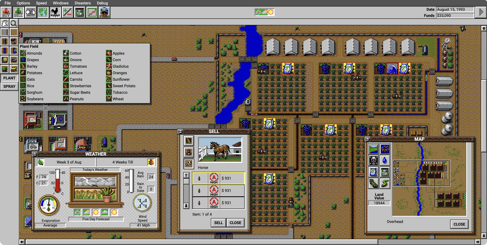
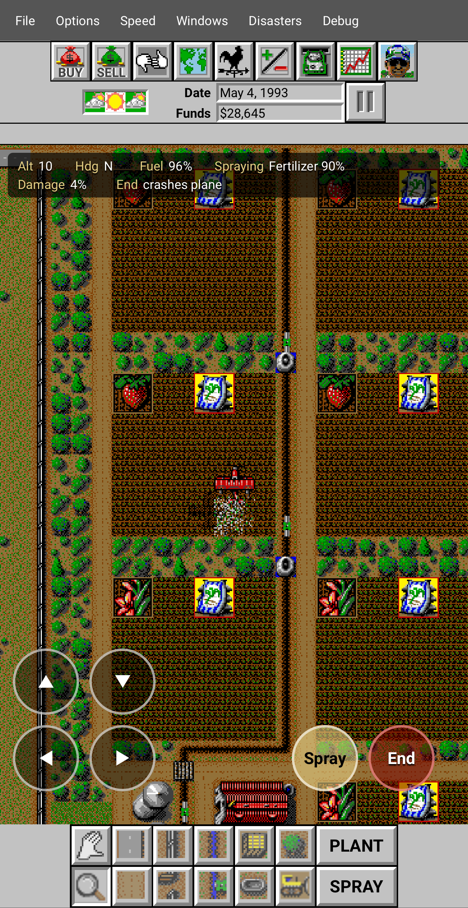

<div align="center">

# SimFarm Web Remake

A remake of SimFarm, the 1993 Maxis classic, as a native TypeScript/React browser game, built with Vite and Bun. No DOS runtime or x86 emulator is used. **Original game assets are not included in this repository.**




</div>

## Differences from the original

The goal is to preserve the original game while adding unobtrusive enhancements:

| Area | Remake behavior |
| --- | --- |
| Crops | All 24 supplied crops are available simultaneously, instead of the original 16 active crop slots and crop-file swapping. Crop definitions and artwork still come from the original files. |
| Timing | Browser pacing, pause, stepping and speed controls replace DOS interrupt timing. At the default 1× speed, one game day takes four real seconds. |
| Saves | The current farm is saved in-browser using IndexedDB, with automatic weekly saves and manual saving. Compressed `.simfarm.json.gz` files provide portable checkpoints. |
| Interface | React controls and HTML text retain original artwork and much of the original layout. Browser fonts replace bitmap lettering. Updated planting menus, crop planners, shops and market views display all 24 crops, with mobile support and touch controls for phone play. |
| Windows | Terrain stays permanently behind dialogs without window chrome. Floating dialogs have movable titlebars; their positions stay outside simulation saves. |
| Browser and touch input | Touch interactions, terrain pinch and Ctrl+wheel zoom, and full-screen home-screen installation supplement the original desktop interface. |
| Audio | Original XMIDI tracks are converted to MIDI and played through libadlmidi-js. Original PCM effects play separately, with overlapping sound effects and cached playback buffers. |
| Machinery | Farms support up to 255 machines, increased from the original limit of 126. Crop dusters can now load and spray fertilizer.|
| Field condition badges | Multiple field problems display together as stacked badges instead of cycling through a single badge slot. |
| Repeated planting | Plant stays selected after placing a field, allowing several fields of the same crop without reopening the menu. |
| Schedule reset | A RESET button in the Schedule window undoes future plan edits by restoring the current crop's default schedule, while preserving the current week and contracts. |
| Debug controls | An expanded Debug menu can trigger town events, expand towns, grow districts and access otherwise hidden content. |
| Preferences | Options are remembered in the browser, including separate music and sound-effects volume controls. |
| Navigation | Spacebar pause, a toolbar pause button, a Farm Expert shortcut and overview-map clicks that center the terrain view provide convenient access. |
| Performance | Incremental terrain redraws, reduced simulation-snapshot copying and fewer updates to closed dialogs reduce unnecessary browser work. |
| Gameplay corrections | Selected original defects are corrected, including, but not limited to spraying more than two fields at a time, crop-income accounting, loan arrears, stored-crop aging and certain crop/climate calculations. Other original quirks remain documented rather than silently changed. |

## Requirements and setup

The provided Bun bootstrap supports macOS and Linux on ARM64 and x86-64. It requires `curl` and `unzip` and downloads the pinned Bun version into the repository. No global Bun installation or separate Node/npm runtime is needed.

**Supply your own original DOS game files** in `../simfarm-dos`, including `SIMFARM.EXE`, `MEGADATA.IDX`, `MEGADATA.EEA`, `CROPS/*.CRP` and `SCEN0.SSM` through `SCEN7.SSM`. 

The archive files used for this reconstruction have these SHA-256 checksums:

| File | SHA-256 |
| --- | --- |
| `MEGADATA.IDX` | `61c7dc75ffe97258c796c353b6dc6420e29477257de145126f1d020f8f3e2a35` |
| `MEGADATA.EEA` | `fc606502cd14cd2de8b84b3769ac273aaefa09872da9608855b206a25e7b7416` |

Run these commands from the repository root:

```sh
sh tools/setup-bun.sh
./tools/bun install --frozen-lockfile
./tools/bun run import
./tools/bun run dev
```

Open the local URL printed by Vite. To import from another directory, replace the import command with:

```sh
./tools/bun run import /path/to/simfarm-dos
```

The importer reads original files without modifying them and generates browser assets in ignored `public/assets/`. Original game files and generated assets are not included in this repository. Re-run import after changes to the importer; see the [generated asset inventory](docs/generated-assets.md).

Dependencies, downloaded tools and caches stay in repository-local `node_modules/`, `.tools/`, `.cache/` and, for optional analysis tools, `.venv/`. Use `./tools/bun` for project commands.

## Build and preview

After installing dependencies and importing assets:

```sh
./tools/bun run build
./tools/bun run preview
```

`build` runs TypeScript checking and creates a production build in `dist/`. `preview` serves that build locally. The built site includes the imported assets and can run without access to the original DOS directory. Vite uses root-relative asset URLs; the current configuration expects hosting at the site root.

## Development and validation

Run unit tests and TypeScript/production-build checks:

```sh
./tools/bun test
./tools/bun run build
```

Install the repository-local browser binaries, then run browser checks:

```sh
PLAYWRIGHT_BROWSERS_PATH=.tools/playwright ./tools/bun run playwright install chromium webkit
./tools/bun run test:browser
```

Tests read the original distribution at `../simfarm-dos`; an alternate importer path does not change test fixture paths. Browser tests also require imported assets and start their own Vite server on port 5190. Keep that port free and runtime files unchanged during a browser run. Some platforms may require Playwright system libraries in addition to the downloaded browsers.

Tests cover source-byte and pixel comparisons, decoder boundaries, recovered simulation rules, checkpoint continuation and browser interactions. See the progress log for the latest results and coverage limits.

Simulation state and rules live in plain TypeScript under `src/simulation`. React subscribes to snapshots and sends commands; UI state stays in `src/ui`, canvas drawing in `src/render`, binary decoding in `src/formats`, asset loading in `src/assets`, and playback in `src/audio`. Optional static-analysis setup is documented in [binary evidence](docs/reverse-engineering.md#static-analysis-tools).

## Documentation

- [Progress and validation](docs/progress.md)
- [Reconstruction plan](docs/plan.md)
- [Binary evidence and static analysis](docs/reverse-engineering.md)
- [Browser saves and autosave](docs/autosave.md)
- [Native checkpoints and compatibility](docs/native-save.md)
- [All-crops adaptation](docs/all-crops.md)
- [Original defects and suspected hazards](docs/original-bugs.md)
- [Intentional gameplay corrections](docs/gameplay-bug-fixes.md)

Subsystem documents in `docs/` record source offsets, hashes, hypotheses, confidence and implementation limits. Some sections describe earlier stages; consult later updates and the progress log for current behavior.

## Credits and license

The original SimFarm was published by Maxis and developed by Eric Albers at Leaping Lizard Software. The reconstructed About dialog retains the original credit pages.

Remake by [Pete Kim](https://x.com/petejkim). Most of the initial work was done using OpenAI Codex. Claude Code was also used for UI development and polishing.

The work contributed to this repository is dedicated under [CC0 1.0 Universal](LICENSE). This dedication does not cover the original SimFarm executable, game data, artwork, music, trademarks or third-party components.
